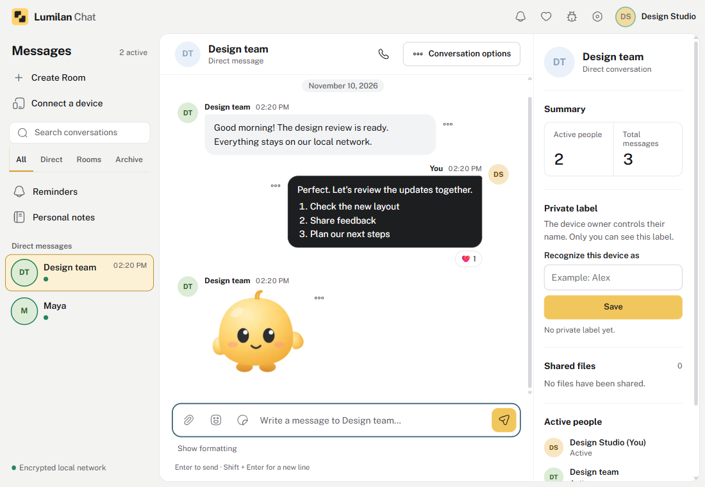
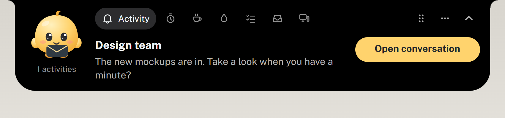
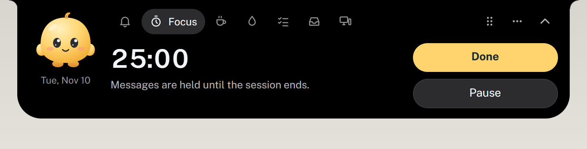
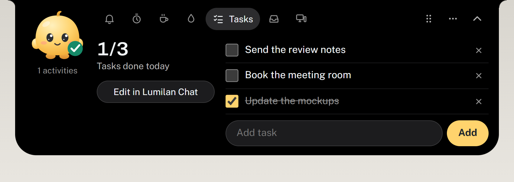
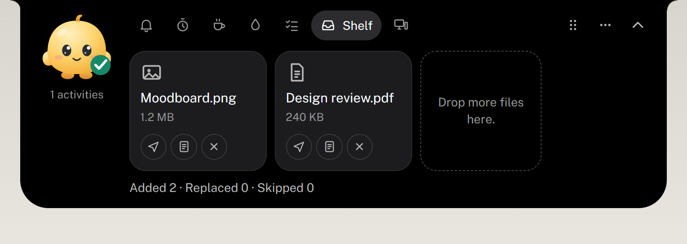
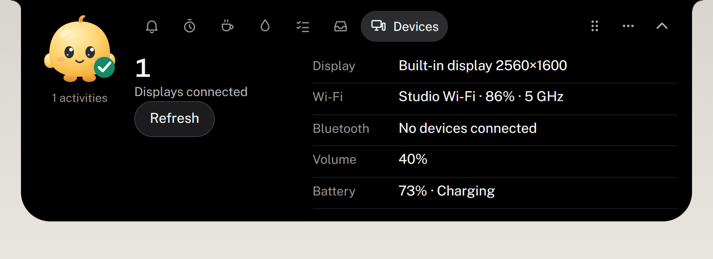
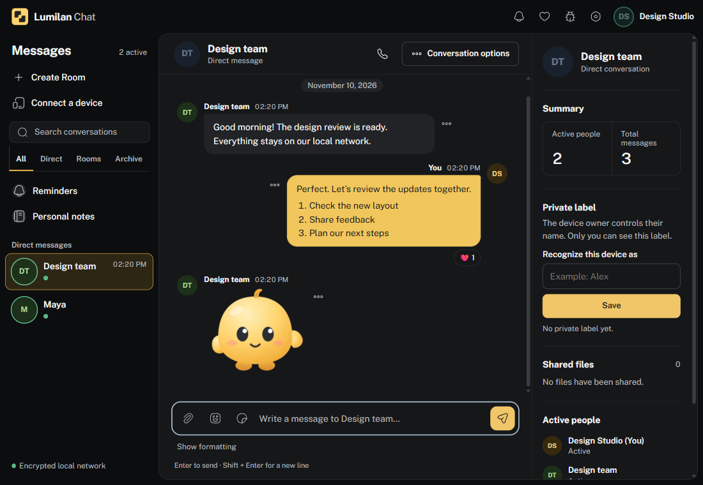
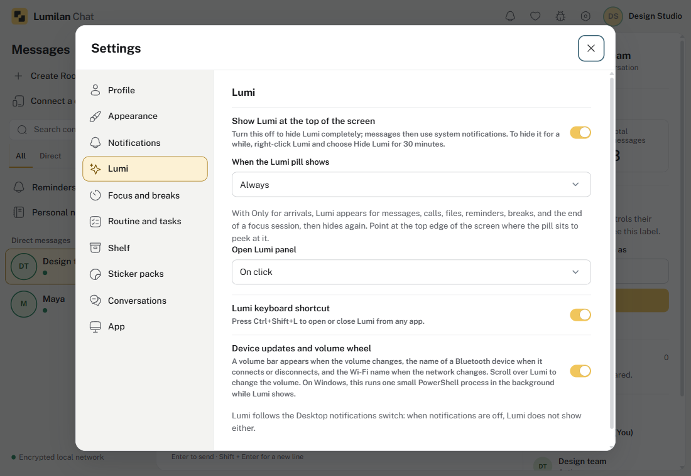

<h1 align="center">Lumilan Chat</h1>

<strong>Your network. Your conversations.</strong> Direct chat, shared files, voice calls, and reminders for your local workspace.

<a href="https://github.com/iyansanjaya/lumilan-chat/releases/latest"><strong>Download Lumilan Chat</strong></a> · <a href="https://github.com/iyansanjaya/lumilan-chat/issues">Report a problem</a> · <a href="README.id.md">Bahasa Indonesia</a>

   

Lumilan connects devices directly on the same LAN or Wi-Fi. No accounts, central chat server, or internet relay. Open the app, choose a name, and start a conversation.

## Meet Lumi

Lumi is a small black island that hangs from the top edge of your screen. When something arrives while you are in another app, it grows into a card, then shrinks back to a pill with the time. It never takes the keyboard from the app you are using, and it waits during Do not disturb, mute, a locked screen, and sleep.

<table>
<tr>
<td width="50%"> <b>Messages, files, and calls</b>: open the conversation, accept or decline a file, answer a call.</td>
<td width="50%">  <b>Your devices</b>: the volume bar follows your volume keys, scroll over Lumi to change it, and headphones or Wi-Fi changes show at a glance.</td>
</tr>
<tr>
<td> <b>Focus</b>: 25, 45, or 60 minutes; contacts see Do not disturb.</td>
<td> <b>Tasks</b>: add and tick off tasks without opening the window.</td>
</tr>
<tr>
<td> <b>Shelf</b>: drop files on Lumi, drag them out, or send them to a contact.</td>
<td> <b>Devices</b>: displays, Wi-Fi, Bluetooth, and volume, read on your computer only.</td>
</tr>
</table>

## A workspace that stays close

| Connect | Make it yours |
| --- | --- |
| **Direct messages & invitation-only Rooms** — talk privately or bring a team together. | **Personal notes** — keep messages and attachments on your own device. |
| **File sharing & image paste** — transfer each file up to 5 GB to compatible clients; paste a copied image, review it, and select Send. | **Reminders** — schedule your own tasks or ask an online contact to choose and accept a time. |
| **Voice calls** — one-to-one audio over your local network. | **Lumi** — a Dynamic Island-style pill with the time that opens into pages, and alerts whenever you are not looking at Lumilan, with system notification fallback where needed. Keep the pill, or let Lumi appear only when something arrives; **Ctrl+Shift+L** (**⌘⇧L**) opens it from any app. |
| **Link previews** — static cards for YouTube, Shorts, and Instagram links (Instagram when available without login); Facebook, Threads, and X get a link card. | **Opt-in fetching** — only your device contacts YouTube or Instagram, and only after you turn it on. |
| **Focus sessions** — start 25, 45, or 60 minutes from Lumi or Settings; contacts see Do not disturb, and your previous status returns afterward. | **One quiet summary** — messages wait during the session; at the end you see how many arrived, without names, text, or marking them read. |
| **Water routine & tasks** — log a drink, get reminders during your active hours, and tick off tasks from Lumi or Settings. | **File shelf** — drop files on Lumi to keep them close, drag them out, send them to a contact, or save them to Personal notes. Lumi's **Devices** page shows displays, Wi-Fi, Bluetooth, and volume at a glance, and Lumi shows a volume bar, Bluetooth names, and Wi-Fi changes as they happen; scroll over Lumi to change the volume (macOS: wheel only, no live volume keys or Bluetooth yet). |
| **Stickers** — import your own image packs and send them from the composer picker; packs stay on your device. | **Shows up at once** — small stickers need no accept step; the receiving device checks and re-encodes every image. |
| **Work breaks** — choose how long to work and rest; Lumi reminds you, then every screen dims with a countdown. | **Back to work anytime** — snooze, skip, or end a break early; breaks wait during Do not disturb, calls, lock, and sleep. |

<strong>See dark mode and settings</strong>

Screenshots come from the Windows build with isolated demo profiles, local test devices, and demo device names; they contain no user conversations.

## Download

> [!WARNING]
> **Current packages are unsigned.** Windows or macOS may show a publisher warning. Download only from the official Releases page. Third-party copies cannot be verified by the maintainer; the maintainer accepts no responsibility for damage, data loss, or security risks caused by them.

Get the latest package from the [official Releases page](https://github.com/iyansanjaya/lumilan-chat/releases/latest). After an update, **Settings → App → What's new** opens once to show what changed.

| System | Choose this package |
| --- | --- |
| Windows 64-bit | `Lumilan Chat Setup *.exe` |
| macOS 13+ Intel | Intel / x64 DMG |
| macOS 13+ Apple Silicon | Apple Silicon / arm64 DMG |
| Linux 64-bit | `*.AppImage` |

Platform-specific features depend on the installed package and desktop environment. Lumi is implemented for Windows, macOS Intel/Apple Silicon, and Linux X11; on macOS it hangs from the top edge of the screen over the menu bar and covers the camera notch where there is one, and Linux Wayland uses system notifications. Build success alone does not establish native compatibility for every feature.

## Start in three steps

1. **Open Lumilan** on devices connected to the same LAN or Wi-Fi.
2. **Choose your name.** Connected devices appear in the direct message list.
3. **Start talking.** Select a person, or use **Create Room** for an invitation-only Conversation Room or an Announcement Room.

Announcement Rooms broadcast to active devices that allow announcements. Direct messages, Room messages, and file transfers require reachable recipients; they are not queued for offline delivery. Reminder contacts are shown only while online and supporting the feature. Personal reminders work locally; requests already created retain their delivery or decision state if a connection drops.

On first launch, supported installed builds enable opening at computer sign-in. Change this in **Settings → App → When the computer starts**. To keep receiving messages after closing the window, enable **Keep running in tray**; a tray must be available.

## Privacy and network limits

Connections use **libp2p Noise** to encrypt traffic and authenticate device identities. Profile names are self-chosen and do not verify a person's identity. Local history, files, and settings are **not encrypted**; use trusted networks and disk encryption where needed.

## Help Lumilan grow

Developed by [Iyan Sanjaya](https://iyansanjaya.com/). Found a problem? Use **Report a bug** in the app header or [open an issue](https://github.com/iyansanjaya/lumilan-chat/issues).

 

Contributions of any size help keep Lumilan improving. The **Support the App** icon offers Trakteer for Indonesia and Ko-fi for international supporters.
